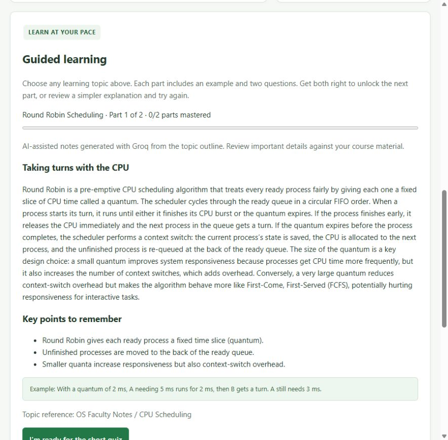

# OSTutorLLM

An adaptive Operating Systems study assistant built with **FastAPI**, **Python**,
and a responsive **HTML/CSS/JavaScript** interface. Learn a topic in small parts,
take a short quiz, and receive a simpler explanation when you need another
attempt. Optional **Groq** integration expands the teaching notes.

**Live app:** [ostutorllm-ygh7.onrender.com](https://ostutorllm-ygh7.onrender.com)

The Render deployment currently serves built-in notes and quizzes. Enable AI
notes by setting `GROQ_API_KEY` in the service's secret environment variables.



## Features

- **19 topics across six categories**, with 38 lesson parts and 76 authored questions.
- **Guided progression:** read a part and answer two questions; both correct
  answers unlock the next part.
- **Simpler review:** incorrect answers show feedback and an easier explanation
  before retrying.
- **Groq notes:** expanded explanations and revision points, with checked
  curriculum examples and local quiz grading.
- **Fallback:** built-in notes remain available without a key, during provider
  errors, or when generated output fails validation.
- **Ask OSTutor:** keyword-based answers with category filters, source labels,
  and four answer styles.
- **Practice quiz:** eight mixed questions graded by question ID after shuffling.
- **White and green interface**, runtime metrics, and interactive API docs.

## Quick start

Requires **Python 3.10+**; Python 3.11+ is recommended.

```bash
git clone https://github.com/ShaunakDhar/OSTutorLLM.git
cd OSTutorLLM
python -m venv .venv
```

Activate the environment:

```powershell
# Windows PowerShell
.\.venv\Scripts\Activate.ps1
```

```bash
# macOS / Linux
source .venv/bin/activate
```

Install dependencies and start the application:

```bash
python -m pip install -r requirements.txt
python -m uvicorn app:app --reload --host 127.0.0.1 --port 8000
```

Open **[the app](http://127.0.0.1:8000)** or the
**[API documentation](http://127.0.0.1:8000/docs)**.
The project works with built-in notes before a Groq key is added.

## Deploy the full app on Render

[](https://render.com/deploy?repo=https://github.com/ShaunakDhar/OSTutorLLM)

The repository includes `render.yaml` for a **free Python web service**. It runs
the frontend and FastAPI backend together, so guided lessons, quizzes and Groq
notes all use the same origin.

1. Open **Deploy to Render**, sign in, and use this repository's Blueprint.
2. Enter `GROQ_API_KEY` as a secret environment variable in Render. The Blueprint
   contains no API key and asks for it during initial setup.
3. Deploy the service and wait until Render marks it live.
4. Open the service's assigned `onrender.com` URL and verify `/api/health`.

Build command: `pip install -r requirements.txt`.
Start command: `python -m uvicorn app:app --host 0.0.0.0 --port $PORT --workers 1`.
The `.python-version` file selects the latest available Python 3.12 patch.

The free service can sleep after inactivity. A restart or sleep clears lesson
sessions and the in-memory note cache. The next visitor may wait for the app to
wake. No database or paid resource is configured.

GitHub Pages cannot run the Python backend. Deploy this repository as a Render
**web service**, rather than as a static site, to keep the full functionality.

See [Render's FastAPI guide](https://render.com/docs/deploy-fastapi) and
[free-service behavior](https://render.com/docs/free).

## Configure Groq locally

1. Create an API key in the [Groq Console](https://console.groq.com/keys).
2. Copy `.env.example` to `.env` in the project root.
3. Set `GROQ_API_KEY` locally, then restart the server.
4. Choose a topic to start a new lesson.

```dotenv
GROQ_API_KEY=your_groq_key_here
GROQ_MODEL=openai/gpt-oss-20b
```

The default model is `openai/gpt-oss-20b`; access depends on the Groq account.
The key is loaded **on the server**. Existing environment variables take
precedence over `.env`. Never put the key in frontend code. `.env` is excluded
from Git; only the empty example configuration belongs in the repository.

Generation sends the bundled topic outline and assessed facts to Groq, without
student answers or identity. Valid generations are cached in memory for one
hour per topic/model. Each lesson uses a frozen copy. Network timeouts, provider
errors and invalid responses fall back to the built-in material.

## Learning workflow

1. Choose a button under **Learning topics**.
2. Read the explanation, revision points when available, and worked example.
3. Select **I’m ready for the short quiz** and answer both questions.
4. With **2/2**, select **Learn next part**. Otherwise, read the simpler
   explanation and retry.
5. Complete both parts, then choose another topic.

Progress survives a refresh in the same tab while the server is running.
Sessions expire after 24 hours of inactivity and reset on server restart.
Selecting a topic starts a new lesson. Use **one server worker** for this prototype.

## Topics

| Category | Topics |
| --- | --- |
| CPU Scheduling | Round Robin, FCFS, Shortest Job First, Priority Scheduling |
| Memory Management | Paging, Segmentation, Virtual Memory, Page Replacement, First Fit |
| Process Management | Process States, Process vs Thread, Context Switching, `fork()` |
| Deadlocks | Necessary conditions, prevention and avoidance, introductory Banker’s algorithm |
| Synchronization | Critical Section, Semaphore and Mutex |
| File Systems | File Allocation Methods, File System Basics |

## Architecture

```text
Browser interface
        |
        v
FastAPI application
        |
        +-- Guided lessons --> Curated outline --> Optional Groq generation
        |                           |
        |                           v
        |                  Validated lesson snapshot
        |                           |
        |                  Local grading and progression
        |
        +-- Ask OSTutor --> Weighted lexical retrieval --> Answer templates
```

Groq improves **lesson notes**. The separate **Ask OSTutor** endpoint uses
keyword retrieval and does not call a language model.

## Tests

```bash
python -m pip install -r requirements-dev.txt
python -m unittest -v test_lessons test_groq_notes
```

The **14 automated tests** cover all topics’ review/retry/progression flows,
invalid and stale submissions, session isolation and expiry, shuffled quiz
grading, output validation, cache behavior, provider failures, and preservation
of checked examples. Provider calls are mocked: no API key or provider charges
are required for this suite.

Run the small lexical retrieval diagnostic with:

```bash
python report_evaluate.py
```

It writes results to the ignored `.report_qa/` directory. See
[TEST_REPORT.md](TEST_REPORT.md) for recorded live results and evidence limits.

## API

| Method | Route | Purpose |
| --- | --- | --- |
| GET | `/api/health` | Status and generation configuration flag |
| GET | `/api/topics` | Topics and categories |
| POST | `/api/ask` | Keyword-based answers |
| POST | `/api/lessons/start` | Start a guided topic |
| GET | `/api/lessons/{session_id}` | Resume a lesson |
| POST | `/api/lessons/{session_id}/check` | Grade the current part |
| POST | `/api/lessons/{session_id}/next` | Advance after passing |
| GET | `/api/quiz` | General practice quiz |
| POST | `/api/quiz/submit` | Grade the general quiz using question IDs |
| GET | `/api/metrics` | In-memory counters |

Example body for `POST /api/lessons/start`:

```json
{"topic_id": "OS-01"}
```

## Project structure

```text
app.py                    API, retrieval, quizzes and lesson sessions
lessons.py                Curated lesson parts and question keys
groq_notes.py             Groq generation, validation, caching and fallback
static/index.html         White and green frontend
static/lessons.js          Guided learning interactions
test_lessons.py            Lesson and quiz regression tests
test_groq_notes.py         Mocked provider tests
report_evaluate.py        Small retrieval diagnostic
docs/images/              Application screenshots
.env.example              Empty configuration template
requirements.txt          Application dependencies
requirements-dev.txt      Test dependencies
```

## Report and scope

- [34-page project report](OSTutorLLM_Project_Report_34_Pages.docx)
- [Requirements comparison](REQUIREMENTS_AUDIT.md)
- [Testing evidence](TEST_REPORT.md)

This educational prototype does **not** yet implement institutional PDF/PPT
ingestion, embeddings, a vector database, document-level RAG, custom model
fine-tuning, a local LLM, automatic lab generation, or durable learner accounts.
Source labels are broad descriptions, not verified page citations.

Generated notes can contain mistakes. Worked examples are preserved from the
curated curriculum; all material should be reviewed before formal teaching or
assessment use. Quiz completion is a workflow state, not validated evidence of
mastery. The small retrieval benchmark shows weak paraphrase matching and
rejection of unrelated questions.

## Troubleshooting

| Symptom | What to check |
| --- | --- |
| Groq notes are not configured | Add the key to `.env` and restart the server. |
| Groq notes are unavailable | Check the key, model access and provider limits; built-in notes still work. |
| Old notes appear | Start a new lesson. Notes are cached for one hour; restarting clears the cache. |
| Progress disappears | Restarting clears server sessions; expired lessons must be restarted. |
| Port 8000 is occupied | Choose another port, for example `--port 8001`. |

## Documentation

[Groq quickstart](https://console.groq.com/docs/quickstart) ·
[Groq JSON output](https://console.groq.com/docs/structured-outputs) ·
[FastAPI](https://fastapi.tiangolo.com/)
